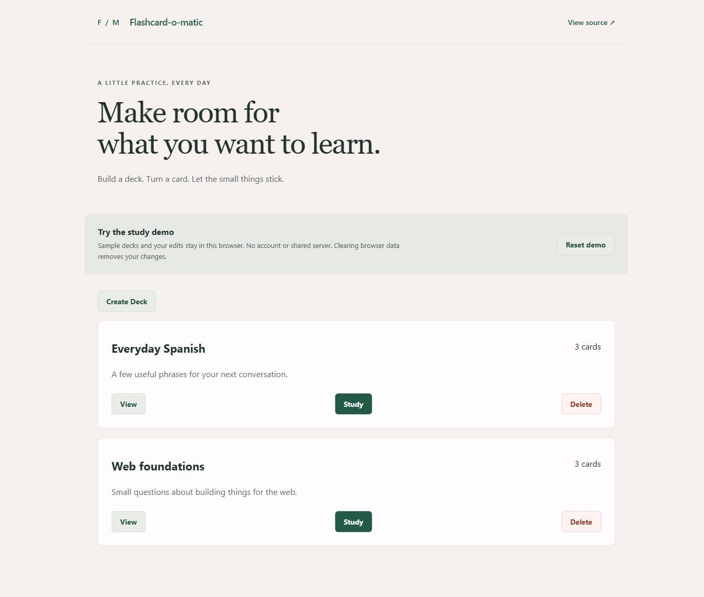

# Flashcard-o-matic

Create a deck, write question-and-answer cards, and study one card at a time. A refreshed Thinkful coursework application demonstrating React forms, routing, and data management.

[Try the live demo](https://flashcard-o-matic-demo.vercel.app/) · [Mobile screenshot](docs/images/mobile.png) · [Verification record](docs/VERIFICATION.md)



## What you can do

- Create, view, edit, and delete decks and cards.
- Flip a study card to reveal its answer, then advance to the next question.
- Restart a completed deck or return to its overview; decks need at least three cards to study.
- Keep demo edits through refresh and return visits in the same browser, or reset the samples.
- Use responsive layouts, labeled forms, keyboard focus indicators, and visible loading, empty, and error states.

## Demo storage

The public demo uses browser local storage. Its sample decks are fictional, and visitors do not share a server database. Clearing site data or choosing **Reset demo** removes edits. Data is not synchronized across devices. Tabs in the same browser share storage; simultaneous changes may overwrite each other. Do not use this demo for important or private study material.

If storage is blocked, full, or unreadable, the app reports the problem. A failed save keeps the form inputs. The demo supports up to 100 decks and 1,000 cards and has no accounts, analytics, or third-party network dependencies.

## My contributions and project context

This began as a Thinkful Software Engineering Bootcamp capstone, using the supplied assignment, app scaffolding, API helper, tests, and sample data. The historical route components implement the deck/card workflows; this is educational work, not a commissioned client application.

The portfolio refresh repairs study progression and restart behavior, fixes form state and submission handling, removes nested interactive controls and reload-based updates, adds visible failures and loading/empty states, and introduces the browser-storage demo adapter and new sample decks. It also adds the responsive visual design, regression tests, reproducible build tools, deployment configuration, and documentation. No private employer source or data is included.

## Run locally

Requires Node.js 22.14 or later and npm. From the repository root:

```sh
npm ci --ignore-scripts
npm run build:demo
npm run preview
```

Open **http://localhost:5102/**. This uses the same browser-storage mode as the public demo.

To use the original HTTP API instead, start the local JSON Server in one terminal:

```sh
npm run start:server
```

Then build and serve the HTTP client in a second terminal:

```sh
npm run build
npm run preview
```

The API listens on **http://localhost:5000/** and writes to `data/db.json`. The frontend listens on port 5102. The included `data/db.json` is the historical coursework fixture; the browser demo has its own clean seeds. Restore the fixture with Git if you want to discard local API edits.

`REACT_APP_API_BASE_URL` overrides the API origin **at build time** for `npm run build`. For example, PowerShell: `$env:REACT_APP_API_BASE_URL='http://localhost:5000'`. Public demo builds ignore that API and use local storage. No credentials or environment variables are needed for the demo. `npm start` builds the HTTP client and serves it; start the API separately.

## Tests and builds

```sh
npm test
npm run build
npm run build:demo
```

There are 21 tests: 10 retained route checks, 6 browser-storage behavior tests, and 5 regression tests for study progression/restart/exit, failed forms, missing records, loading/empty states, and deck submission. The tests use an injected storage adapter and mocked HTTP helpers; they are supplemented by the browser and HTTP walkthroughs recorded in [verification](docs/VERIFICATION.md). GitHub Actions runs the tests and both builds.

## Structure and technical choices

- React 16 and React Router 5 preserve the original coursework's route/component model.
- `src/Layout/` contains the library, forms, deck overview, and study screens.
- `src/utils/api/index.js` selects the HTTP or browser adapter at build time.
- `src/utils/api/http.js` retains the JSON Server contract; `browser.js` provides persistent demo CRUD and validation.
- esbuild produces a static `build/` artifact. Local styles replace CDN scripts, icons, and framework dependencies.
- Vercel serves the demo with SPA rewrites, so direct links and refresh on deck routes work. Its content security policy blocks network connections from the application.

Routes: `/`, `/decks/new`, `/decks/:deckId`, `/decks/:deckId/edit`, `/decks/:deckId/study`, `/decks/:deckId/cards/new`, and `/decks/:deckId/cards/:cardId/edit`.

## Hosting and limitations

`vercel.json` builds the browser demo and serves only `build/`. The local JSON Server is unauthenticated development tooling, bound to loopback; do not expose it as a production API. There is no user authentication, backup service, multi-user synchronization, or production backend in this project.

Deployment currently uses the Vercel CLI in the existing account. Automatic GitHub deployment is not connected. After building and testing, an authenticated maintainer can publish with `vercel --prod --scope traviscow`.

The refresh removes the obsolete Create React App build chain. At verification, the production dependency audit reports no known advisories; the test toolchain still has moderate transitive advisories, recorded in the verification document. A future platform upgrade should modernize React/Router and the testing stack together. Other useful extensions are export/import and accessible in-page confirmation dialogs.
